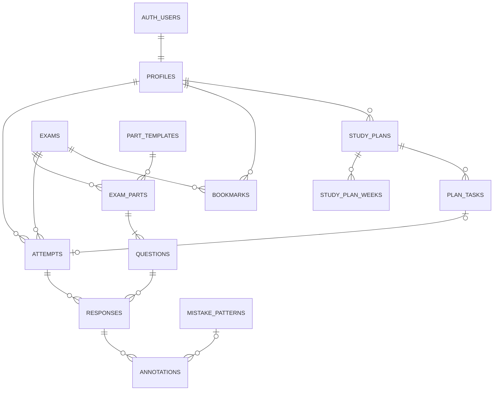

# ERD — Toeco

Bản thiết kế dữ liệu đích. Code frontend mirror ở `lib/domain/types.ts` (tên cột snake_case trùng DB).
Trạng thái: **[x]** đã có type trong `lib/domain`, **[ ]** đã chốt nhưng chưa vào code. Chưa bảng nào có migration ngoài `profiles` (bản rút gọn).

## Quan hệ

## Bảng

`PK` khoá chính · `FK` khoá ngoại · `?` nullable

### Người dùng

- [x] **profiles** — `id` PK/FK auth.users · `full_name?` · `avatar_url?` · `role` (student | admin) · `target_speaking?` · `target_writing?` · `exam_date?` · `preferred_time?` · `reminder_enabled` · `created_at` · `updated_at`
  - Migration hiện có mới gồm `id, full_name, avatar_url, created_at, updated_at`.

### Ngân hàng đề

- [x] **part_templates** (dữ liệu tĩnh, seed theo format ETS — xem `lib/domain/parts.ts`) — `id` PK · `skill` · `part_no` · `q_from` · `q_to` · `task` · `context_sec?` · `prep_sec?` · `response_sec smallint[]?` (theo từng câu) · `section_sec?` (đồng hồ chung cả Part)
- [x] **exams** — `id` PK · `skill` (speaking | writing) · `code` UK · `title` · `edition` (năm) · `source` (ets | internal) · `status` (draft | review | published) · `is_verified` · `topic` · `target_level?` · `description?` · `tags text[]` · `review_note?` · `created_by?` FK profiles · `published_at?` · `created_at` · `updated_at`
- [x] **exam_parts** — `id` PK · `exam_id` FK · `part_template_id` FK · `description?` · `context?` · `context_media_path?` — UK (`exam_id`, `part_template_id`)
- [x] **questions** — `id` PK · `exam_part_id` FK · `number` · `prompt` · `stimulus?` (ngữ liệu riêng của câu, vd email Q6-7) · `image_path?` · `image_alt?` · `audio_path?` · `keywords jsonb?` (Writing Q1-5) · `sample_answer?` · `hint?` — UK (`exam_part_id`, `number`)

### Bài làm

- [x] **attempts** — `id` PK · `user_id` FK · `exam_id` FK · `part_template_id?` FK (null = cả đề) · `mode` (cbt | timed | guided) · `status` (in_progress | submitted | scoring | scored | interrupted) · `sample_viewed` · `started_at` · `ends_at?` (server giữ) · `submitted_at?` · `scored_at?` · `score?` (0-200) · `feedback_summary?` · `scoring_error?`
- [x] **responses** — `id` PK · `attempt_id` FK · `question_id` FK · `text_answer?` · `audio_path?` · `transcript?` · `score?` · `max_score?` · `metrics jsonb` · `strengths jsonb` · `updated_at` — UK (`attempt_id`, `question_id`)
- [x] **annotations** — `id` PK · `response_id` FK · `mistake_pattern_id?` FK · `start_offset` · `end_offset` · `quote` · `correction` · `explanation` · `criterion` · `severity` · `at_sec?`
- [x] **bookmarks** — PK (`user_id`, `exam_id`) · `created_at`

### Sổ lỗi

- [x] **mistake_patterns** — `id` PK · `skill` · `part_template_id?` FK (null = mọi Part) · `title` · `summary` · `why` · `criteria text[]` · `severity` · `impact` · `remedy jsonb`

### Lịch học

- [x] **study_plans** — `id` PK · `user_id` FK · `minutes_per_day` (mỗi ngày học một buổi) · `days_per_week` · `status` (active | archived) · `ai_rationale?` · `created_at`
- [x] **study_plan_weeks** — PK (`plan_id`, `week_no`) · `theme` — tuần 1 là tuần (Thứ 2 – Chủ nhật) chứa `study_plans.created_at`
- [x] **plan_tasks** — `id` PK · `plan_id` FK · `scheduled_date` · `sort_order` · `kind` (speaking | writing | review | mock | summary) · `title` · `description?` · `goal?` · `duration_min` · `exam_id?` FK · `part_template_id?` FK · `mistake_pattern_id?` FK · `attempt_id?` FK UK (phòng thi ghi khi nộp bài mở từ task) · `completed_at?` (task không cần bài làm: review, summary) — task xong khi có `attempt_id` hoặc `completed_at`
- [x] **ai_insights** — `id` PK · `user_id` FK · `payload jsonb` · `generated_at`
  - `payload`: `{ based_on_attempts, items: [{ skill, part_template_id?, mistake_pattern_id?, title, metric, tone (critical | warning), body, action_label, href }] }`

### Tra cứu

- [x] **score_levels** — PK (`skill`, `min_score`) · `level` — seed theo ETS, xem `lib/domain/score-levels.ts`

## View (tính ra, không lưu)

- [x] **exam_stats** — `exam_id` · `attempt_count` · `completion_rate`
- [x] **user_mistake_stats** — `user_id` · `mistake_pattern_id` · `status` (active | improving | resolved) · `hit_count` · `window_count` · `clean_streak` · `occurrence_count` · `last_seen_attempt_id?` · `last_seen_at?` · `priority` — logic tính hiện ở `app/mistakes/_lib/data.ts`
- [x] **user_skill_stats** — `user_id` · `skill` · `attempt_count` · `scored_count` · `latest_score?` · `latest_scored_at?` · `total_minutes`
- [x] **user_part_stats** — `user_id` · `part_template_id` · `attempt_count` · `avg_score_ratio?` (0-1)
- [x] **user_study_stats** — `user_id` · `streak_days` · `best_streak_days` · `minutes_this_month`

## Quy ước

- Không có đề Full Test: Speaking và Writing là hai đề, hai lượt làm riêng.
- Khách làm bài: dữ liệu chỉ ở localStorage (`lib/data/user-data.ts`), không lên DB, không chuyển sang khi đăng ký → `attempts.user_id` vẫn NOT NULL.
- RLS: học viên chỉ đọc đề `published`; chỉ `admin` ghi bảng nội dung; dữ liệu bài làm, đánh dấu, lịch học chỉ chủ sở hữu thấy; `annotations` chỉ service role ghi.
- Storage: bucket `exam-media` (công khai), `recordings` (riêng theo user).
